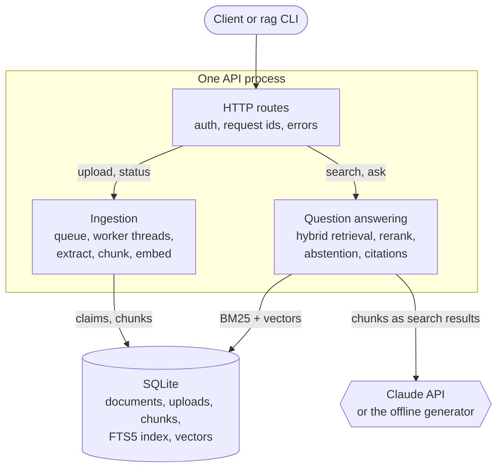
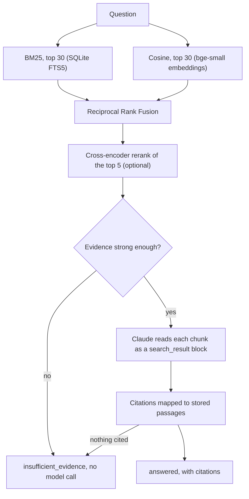

# Production RAG — Ask My Docs

[](https://github.com/saicharan-nidiganti/production-rag/actions/workflows/ci.yml)

[](LICENSE)

A retrieval-augmented question-answering backend that answers from your documents, cites
the exact passages it used, says so when the documents don't contain the answer, and
measures itself against a versioned evaluation set on every commit.

> **Status.** The v0 backend works end to end and is checked in CI: background ingestion,
> hybrid retrieval with reranking, cited answers, abstention, an HTTP API, a CLI and
> evaluation gates. Answers from Claude are implemented but **not yet measured live**:
> the paid evaluation awaits the owner's approval and API credit. Accounts, streaming and
> a web UI are planned. Details: [docs/status.md](docs/status.md).

## Why

Internal documentation (runbooks, policies, API guides) is where people need answers they
can trust and check. A basic "retrieve and generate" prototype falls short in predictable
ways: it invents details, cites the wrong passage, answers questions the documents can't
answer, follows instructions hidden in a document, and gets worse without anyone
noticing. This project treats each of those as an engineering requirement with a test or a
gate behind it:

- Every citation maps to a stored passage, with document, section heading or page, and
  character offsets.
- The system abstains before calling a model when retrieval finds no usable evidence.
- Document text is passed to the model as data, never as instructions.
- Retrieval quality is a CI gate on a held-out split, so a regression fails the build.

It is built for teams who want a self-hosted question-answering service over their own
documents, and as a worked example of taking RAG from prototype to an engineered service.

## What works today

| Capability | State |
| --- | --- |
| Ingestion of `.txt`, Markdown and PDF, in the background, with a status per document, retry and crash recovery | **Implemented and verified**: tests, a real-server smoke test in CI, and manual checks with killed and restarted servers |
| Hybrid retrieval (BM25 + vectors, fused) with optional cross-encoder reranking | **Implemented and verified**: CI gate for the offline configuration; free gates for the recommended models, run locally |
| Abstention on off-topic questions before any model call | **Implemented and verified**: 4 of 4 held-out off-topic questions, with no false abstentions |
| Grounded answers from Claude with native citations | **Implemented, not verified live**: tested offline against a fake client; the paid evaluation hasn't run |
| Declining on-topic questions the documents can't answer; resisting a planted prompt injection | **Not verified**: both depend on Claude and are what the pending paid evaluation measures |
| Accounts and per-user isolation, answer streaming, DOCX and HTML, web UI | **Planned** ([roadmap](docs/roadmap.md)) |

## Architecture



A single process serves the API and runs the ingestion workers. SQLite holds everything,
including the queue, so there is nothing else to operate
([ADR-0002](docs/decisions/0002-v0-storage-and-scope.md),
[ADR-0006](docs/decisions/0006-background-ingestion.md)). Package dependencies point one
way, and a test enforces it. Component and sequence diagrams are in
[docs/architecture.md](docs/architecture.md).

### How a question is answered



- **Ingestion.** An upload is checked (type, size, PDF signature, UTF-8), deduplicated by
  SHA-256, stored and queued, and the request returns `202`. A worker extracts sections
  (Markdown headings, PDF pages), chunks them without crossing section boundaries, embeds
  each chunk with its heading path, and writes the chunks in the transaction that marks the
  document `ready`. A crashed worker's document is taken over once its lease lapses.
- **Retrieval.** BM25 and exact cosine search each return 30 candidates; Reciprocal Rank
  Fusion merges them by rank, so their scores never need calibrating against each other.
- **Reranking.** A local cross-encoder (`ms-marco-MiniLM-L-6-v2`) rescores the top 5 fused
  candidates, reading question and passage together ([ADR-0005](docs/decisions/0005-reranking-and-abstention.md)).
- **Abstention.** If the best cosine or rerank score is below its threshold, calibrated on
  the dev split, the answer is `insufficient_evidence` and no model is called.
- **Citations.** Claude receives each chunk as a `search_result` block with citations
  enabled. Each cited span maps back to a chunk by index; an answer that cites nothing is
  reported as `insufficient_evidence`, not `answered` ([ADR-0003](docs/decisions/0003-generation-provider-claude.md)).

## Results

Retrieval on the held-out test split of [golden v2](docs/evaluation.md#golden-dataset)
(58 of 94 questions; thresholds were calibrated on the other 36). Top 5 chunks. Latency is
over all 94 questions on a laptop CPU and varies between runs (the reranked p95 measured 70
to 107 ms on the same machine).

| Configuration | Hit rate | MRR | Unanswerable declined at retrieval | False abstentions | Retrieval p95 |
| --- | --- | --- | --- | --- | --- |
| Hashing embeddings, hybrid (offline; the CI gate) | 0.957 | 0.859 | 0 of 12 | 0 | 1 ms |
| bge-small, hybrid | 1.000 | 0.931 | 4 of 12 | 0 | 8 ms |
| **bge-small, hybrid, reranked (recommended)** | **1.000** | **0.946** | 4 of 12 | 0 | 107 ms |

The 4 declined questions are all off-topic. None of the 8 on-topic unanswerable questions
can be caught at retrieval by any signal tried, so declining them is the generator's job,
which is unmeasured until the paid run.

These numbers come from 94 questions written alongside a 9-document synthetic corpus. They
are a regression baseline for this project, not a benchmark. Metrics, calibration and
limitations: [docs/evaluation.md](docs/evaluation.md). The raw reports behind this table,
with every question's retrieved passages, scores and latencies, are in
[eval/results/2026-10-29/](eval/results/2026-10-29/). Reproduce them with
`uv run python scripts/compare_configs.py`.

## Quickstart

Requires Python 3.12+ and [uv](https://docs.astral.sh/uv/).

```bash
git clone https://github.com/saicharan-nidiganti/production-rag.git && cd production-rag
uv sync --all-extras              # locked dependencies, including fastembed for local models
uv run rag db upgrade             # create the SQLite schema in data/rag.db
uv run rag ingest eval/corpus     # ingest the sample handbook
uv run rag ask "How long does the canary run?"
uv run rag serve                  # http://127.0.0.1:8000, interactive docs at /docs
```

With no configuration this runs fully offline: lexical `hashing` embeddings and the
`extractive` generator, which quotes retrieved sentences instead of writing an answer. For
real use, copy `.env.example` to `.env`; it selects `bge-small` embeddings, reranking and
Claude (`ANTHROPIC_API_KEY` required). The models download on first use (about 150 MB).

## API

```bash
export RAG_URL=http://127.0.0.1:8000
export RAG_API_KEY=replace-with-your-key      # only if the server sets RAG_API_KEY

# Upload: returns 202 and a Location to poll until "status" is "ready" or "failed".
curl -s "$RAG_URL/v1/documents" -H "Authorization: Bearer $RAG_API_KEY" \
  -F "file=@eval/corpus/deployment-runbook.md"
curl -s "$RAG_URL/v1/documents/<document-id>" -H "Authorization: Bearer $RAG_API_KEY"

# Ask.
curl -s "$RAG_URL/v1/query" -H "Authorization: Bearer $RAG_API_KEY" \
  -H "Content-Type: application/json" -d '{"question": "How long does the canary run?"}'
```

A real response from the offline configuration, abridged (`retrieved`, ids and timings
omitted):

```json
{
  "status": "answered",
  "answer": "Production rollouts start with a canary. The canary receives 5% of production traffic for 30 minutes. During that window the pipeline compares the canary's error rate and p99 latency with the stable fleet.",
  "segments": [
    {"text": "Production rollouts start with a canary. ", "citations": [0]},
    {"text": "The canary receives 5% of production traffic for 30 minutes. ", "citations": [1]}
  ],
  "citations": [
    {"source_name": "deployment-runbook.md", "heading": "Deployment Runbook > Canary releases",
     "start_char": 574, "end_char": 1084, "cited_text": "Production rollouts start with a canary."}
  ],
  "model": "extractive-v1"
}
```

An off-topic question ("What is the capital of France?") returns `"status":
"insufficient_evidence"` with no citations. `status` is `answered`, `insufficient_evidence`
or `refused`. Every endpoint, field and error code, with real responses:
[docs/api.md](docs/api.md).

## Configuration

Settings are `RAG_*` environment variables or a `.env` file. The ones that matter most:

| Variable | Default | Purpose |
| --- | --- | --- |
| `RAG_EMBEDDING_PROVIDER` | `hashing` | `fastembed` for semantic embeddings (recommended) |
| `RAG_RERANKER` | `none` | `fastembed` for cross-encoder reranking (recommended) |
| `RAG_GENERATOR` | `extractive` | `anthropic` for Claude; needs `ANTHROPIC_API_KEY` |
| `RAG_API_KEY` | unset | When set, `/v1/*` requires it as a bearer token |
| `RAG_DATABASE_URL` | `sqlite:///data/rag.db` | SQLite only in v0 |
| `RAG_INGEST_WORKERS` | `1` | Background ingestion threads per API process |

All settings, with defaults and trade-offs: [docs/configuration.md](docs/configuration.md).
Deployment, monitoring, backups and troubleshooting: [docs/operations.md](docs/operations.md).

## Development

```bash
make install     # uv sync --frozen --all-extras
make check       # lock check, lint, mypy --strict, tests with coverage, retrieval gate
make smoke       # start a real server; upload, wait for ingestion, search, ask
make help        # every target
```

CI runs these same targets on Python 3.12, 3.13 and 3.14. Other jobs build the wheel and run the
CLI from it, scan for secrets (gitleaks), audit the locked dependencies (pip-audit, also
weekly) and lint the Markdown. Without make, [CONTRIBUTING.md](CONTRIBUTING.md#checks)
lists the plain `uv` commands.

The default test suite is offline and free. Two opt-in groups need more:

```bash
RAG_RUN_LIVE_TESTS=1 uv run python -m pytest tests/integration/test_live.py   # downloads models; free
uv run rag eval --plan --tags unanswerable-ontopic,injection                 # preview a paid run: calls, cost
```

Anything that calls Claude needs an explicit `--allow-paid` (or `RAG_RUN_PAID_TESTS=1`) and
the maintainer's approval; CI never makes paid calls.

## Security and limitations

- **Single tenant.** Anyone with the API key can read and delete every document. Accounts
  and isolation arrive with PostgreSQL in Phase 5.
- **Unverified generation.** Claude's citation quality, declining of unanswerable
  questions and prompt-injection resistance are designed for and tested offline, but not
  yet measured.
- **Parsing runs in the API process.** A hostile file can exhaust its memory; restrict
  uploads to trusted users until parsing moves to an isolated worker.
- **Data sent to Anthropic.** With the Claude generator, questions and retrieved passages
  go to the Claude API. Logs never contain document text or questions.
- **Small evaluation set.** 94 author-written questions; results are optimistic and coarse.

Controls, data flows and known gaps: [docs/security.md](docs/security.md). Report
vulnerabilities privately: [SECURITY.md](SECURITY.md).

## Roadmap

1. The first paid Claude evaluation, focused on on-topic unanswerable questions and the
   planted injection (prepared, with a cost preview; awaiting approval and credit).
2. DOCX and HTML ingestion; streaming answers.
3. Accounts and per-user isolation on PostgreSQL with pgvector.
4. A web interface.

The phase-by-phase plan is in [docs/roadmap.md](docs/roadmap.md); decisions and their
trade-offs are in the [ADRs](docs/decisions/README.md).

## Project layout

```text
src/production_rag/   the package: api/, ingestion/, retrieval/, generation/, db/, evaluation/, cli.py
tests/                unit/ and integration/ (offline); live and paid tests are opt-in
eval/                 synthetic corpus, golden datasets, regression thresholds
docs/                 requirements, architecture, API, operations, security, evaluation, ADRs
scripts/              smoke test and the configuration-comparison experiment
data/                 local working data and the default database (git-ignored)
```

All documentation: [docs/README.md](docs/README.md).

## Contributing and license

Contributions are welcome: see [CONTRIBUTING.md](CONTRIBUTING.md) and the
[code of conduct](CODE_OF_CONDUCT.md). Notable changes are in [CHANGELOG.md](CHANGELOG.md).
Licensed under the [MIT License](LICENSE).
