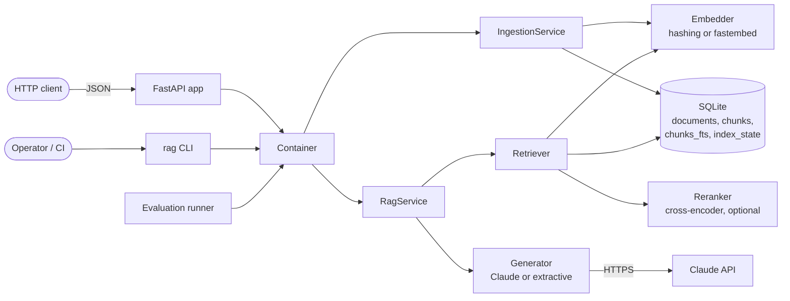
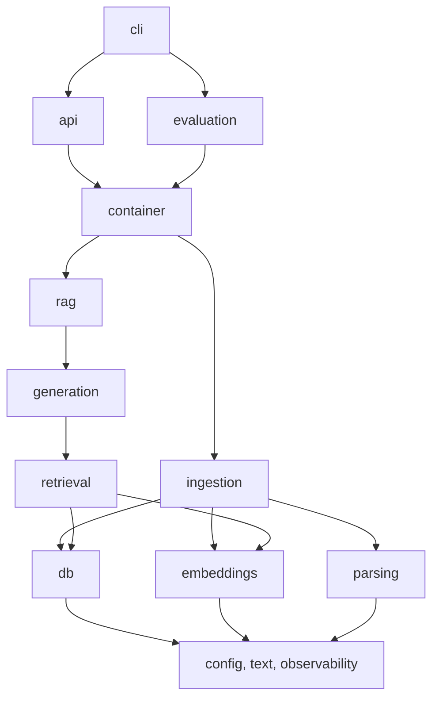
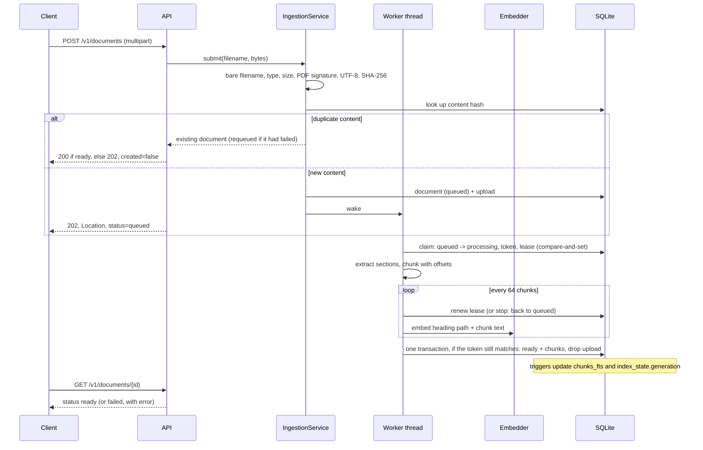
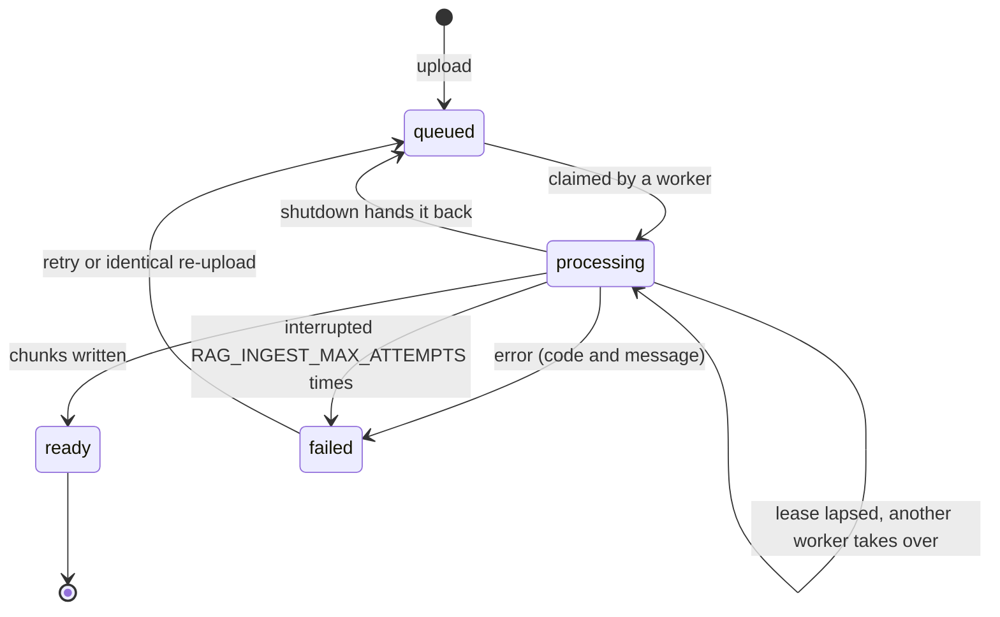
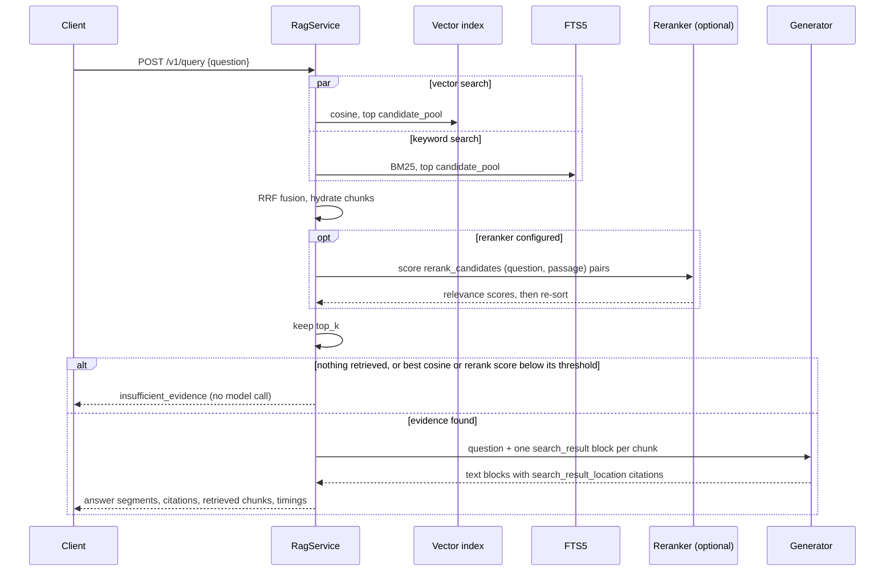
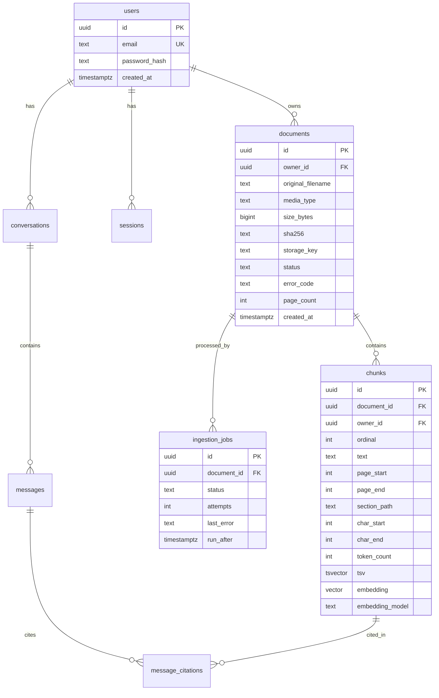

# Architecture

This document describes the **v0 backend as implemented**, then the path to the
v1 target defined in [ADR-0001](decisions/0001-technology-stack.md) and
[requirements.md](requirements.md). The reasoning behind each choice is in
[decisions/](decisions/).

## 1. Principles

1. **Evidence first.** Every answer can be traced back to stored chunks. A
   citation that does not map to retrieved evidence is a bug.
2. **Documents are untrusted input.** They can contain malicious files or
   prompt-injection text, and are handled as data, never as instructions.
3. **Swappable, measurable stages.** Extraction, chunking, embedding,
   retrieval and generation sit behind interfaces, so each can be evaluated
   and replaced on its own.
4. **Few moving parts.** v0 is one process type and one database file.
5. **Isolation at the data layer** (v1). Ownership filters will be part of
   every query that reads documents, chunks or vectors. v0 is single tenant.

## 2. System context (v0)



`container.build_container(settings)` constructs every component from
`Settings`. The API, the CLI and the evaluation runner all use it, so they
can't drift apart in how they assemble the system.

## 3. Code layout

```text
src/production_rag/
  config.py          Settings (RAG_* environment variables, .env)
  observability.py   JSON logging, request-id context, stage timer
  text.py            tokenization shared by embeddings, lexical search, evaluation
  db/                SQLAlchemy models, engine, Alembic migrations (single source of schema truth),
                     document queries (documents.py)
  embeddings.py      Embedder protocol: hashing and fastembed providers
  parsing/           text extraction (txt, md, pdf), and the isolated parser process that runs it
  ingestion/         chunking, the queue's claim protocol (queue.py),
                     processing (pipeline.py), worker threads
  retrieval/         vector index, FTS5 search, RRF fusion, cross-encoder reranking, retriever
  generation/        Generator protocol: Claude and extractive generators, answer types
  rag.py             query orchestration and abstention
  container.py       component wiring
  api/               FastAPI app, routes, schemas, auth, error mapping (transport only)
  cli.py             rag command (transport only)
  evaluation/        golden dataset, metrics, runner, regression gate
eval/                corpus, golden dataset, gate thresholds (versioned evaluation inputs)
scripts/             reproducible experiments (compare_configs.py prints the evaluation tables)
tests/               unit/ and integration/ (offline), plus live tests behind a flag
```

Dependencies point one way, layer by layer. A module may import from its own
package or a lower layer, never sideways or up, and
[test_architecture.py](../tests/unit/test_architecture.py) fails CI on any import
that breaks this:



`ingestion` and `retrieval` never import each other: they share only the
database schema and the embedder. HTTP handlers hold no SQL; document queries
live in `db/documents.py`, and every processing-state change goes through
`ingestion/queue.py`.

## 4. Ingestion

Uploads are accepted at once and processed in the background (FR-3,
[ADR-0006](decisions/0006-background-ingestion.md)). The queue is the
`documents` table itself, so it needs no broker, and it survives restarts
because the upload is stored with the document until processing succeeds.





1. **Validate** (at upload). The filename is reduced to a bare name. The type
   must be `.txt`, `.md`/`.markdown` or `.pdf`, and the size within
   `RAG_MAX_UPLOAD_BYTES`. Checks that need no parsing run here too: a `.pdf`
   must start like a PDF, and text must be non-blank UTF-8. These fail the
   request; nothing is stored.
2. **Deduplicate** by SHA-256 of the raw bytes (FR-4). A unique index also
   covers concurrent uploads of the same file. A duplicate returns the existing
   document in whatever state it is; a failed one is queued again.
3. **Queue.** The document row (`queued`) and its upload (`document_files`)
   are written in one transaction, and the request returns.
4. **Claim.** A worker moves the oldest queued document to `processing` with
   one conditional `UPDATE` (status and token must still match), so threads and
   processes sharing the database never process the same document twice. The
   claim carries a lease of `RAG_INGEST_LEASE_S`, renewed before each embedding
   batch. If the worker dies, the lease lapses and another worker takes the
   document over; a worker that comes back after losing its claim discards its
   work. A document interrupted `RAG_INGEST_MAX_ATTEMPTS` times is failed
   (`interrupted`) instead of retried forever.
5. **Extract** ([extract.py](../src/production_rag/parsing/extract.py)) full
   text plus *sections*, in a separate parser process
   ([ADR-0007](decisions/0007-isolated-document-parsing.md)). The file goes in
   on stdin and the result comes back as JSON. The process has no secrets in
   its environment, is killed after `RAG_PARSE_TIMEOUT_S`, and on Linux and
   macOS runs under a memory limit. A file that hangs or crashes the parser
   fails its own document (`parse_timeout`, `parse_failed`) and leaves the
   service running. The sections are:
   - Markdown: one section per heading, carrying the heading path
     (`Guide > Install > Windows`). Headings inside code fences are ignored, and
     headings without a body of their own are skipped.
   - PDF: one section per page (pypdf), carrying the page number. Encrypted
     PDFs, PDFs over `RAG_MAX_PDF_PAGES`, and PDFs without a text layer (scanned)
     are rejected with a clear error.
   - Text: UTF-8 (BOM tolerated), newlines normalized. Other encodings are
     rejected rather than guessed.
6. **Chunk** ([chunking.py](../src/production_rag/ingestion/chunking.py)).
   Chunks never cross a section boundary. Each is at most `RAG_CHUNK_SIZE`
   characters (default 1000) and ends at the best break in the second half of
   the window: a paragraph break, else a sentence end, else whitespace, else a
   hard cut. Consecutive chunks overlap by up to `RAG_CHUNK_OVERLAP` characters
   (default 150), and a chunk starts on a word boundary where possible.
   `text[start:end] == chunk.text` is a tested invariant, and so is
   determinism: the same text and settings give the same chunks. Each chunk
   gets a stable `chunk_key`, a hash of the document's content hash and its
   span. Re-ingesting identical bytes reproduces every key, even though row ids
   change ([test_chunk_keys.py](../tests/integration/test_chunk_keys.py)).
7. **Embed** the chunk text, prefixed with its heading path for context, in
   batches of 64.
8. **Complete** in one transaction: the document becomes `ready` with its
   extracted text (kept for re-chunking and audit), its chunks are inserted, and
   the stored upload is deleted. A failure marks the document `failed` with a
   code and a message and writes no chunks (NFR-5). Its upload is kept so it can
   be retried.

Raw uploads are stored in the database only until processing succeeds: while a
document is queued, processing or failed. Deleting a document deletes its
upload. Workers are threads in each API process (`RAG_INGEST_WORKERS`); the
CLI and the evaluation runner process in the calling thread (`ingest`).

## 5. Storage

SQLite through SQLAlchemy 2, with the schema owned by Alembic migrations
([versions/](../src/production_rag/db/migrations/versions/): 0001 initial schema, 0002 ingestion status, 0003 stable chunk keys).
[ADR-0002](decisions/0002-v0-storage-and-scope.md) (accepted) explains why v0
departs from ADR-0001's PostgreSQL design.

| Table | Purpose |
| --- | --- |
| `documents` | One row per unique upload: name, title, type, content hash, size, chunk count, extracted text, metadata, and processing state (status, error code and message, attempts, claim token, lease expiry, last status change) |
| `document_files` | The uploaded bytes of documents not yet ready |
| `chunks` | Text, character offsets, stable chunk key, heading path, page, embedding (float32 little-endian blob) and the embedding model id |
| `chunks_fts` | External-content FTS5 index over `chunks.text`, using the Porter stemmer |
| `index_state` | Single row with a `generation` counter |

Triggers on `chunks` keep `chunks_fts` in sync and increment
`index_state.generation` on every insert, update and delete. Foreign keys
cascade document deletes to chunks and stored uploads, and the triggers then
clean the FTS index.
Connections enable `foreign_keys`, WAL journaling and a 5 s busy timeout. An
integration test compares the ORM models with the migrated schema, so a model
change without a migration fails CI.

## 6. Retrieval



[retriever.py](../src/production_rag/retrieval/retriever.py) supports three
modes:

- **lexical:** BM25 from FTS5. The query is reduced to content terms, each term
  is quoted (which neutralizes FTS5 operators in user input), and the terms are
  OR-ed together.
- **vector:** exact cosine similarity against an in-memory matrix of the
  current embedding model's vectors. The matrix is reloaded only when
  `index_state.generation` changes, which keeps separate worker processes
  consistent without shared memory. Measured cost: about 0.5 ms per query at
  10k chunks and 6 ms at 100k.
- **hybrid** (default): both retrievers fetch `RAG_CANDIDATE_POOL` candidates
  (default 30), then Reciprocal Rank Fusion (`k = 60`) merges them. RRF uses
  only ranks, so BM25 and cosine scores never need calibrating against each
  other.

**Reranking** (optional, `RAG_RERANKER=fastembed`,
[reranking.py](../src/production_rag/retrieval/reranking.py)): the top
`RAG_RERANK_CANDIDATES` fused candidates (default 5) are scored by a local
cross-encoder (`Xenova/ms-marco-MiniLM-L-6-v2`), which reads the question and
the passage together. They are re-sorted by that score and cut to `top_k`, so
the reranker can promote a chunk from below the cut. It costs about 30 ms per
query on a laptop CPU at 5 candidates, about 250 ms at 20.
[ADR-0005](decisions/0005-reranking-and-abstention.md) has the measurements.

Embeddings: `hashing` is a deterministic, dependency-free feature-hashing
model (lexical only). `fastembed` runs `BAAI/bge-small-en-v1.5` locally through
ONNX Runtime. Each chunk records its embedding model id. Vectors from other
models are never compared, `/ready` reports them as stale chunks, and
`rag reindex` re-embeds them.
[ADR-0004](decisions/0004-embeddings-hybrid-retrieval-and-abstention.md) has
the measurements.

## 7. Generation and citations

[rag.py](../src/production_rag/rag.py) orchestrates a query:

1. Retrieve `top_k` chunks.
2. **Abstain before generation** when nothing was retrieved, when the best
   cosine is below the embedding provider's calibrated threshold, or, with a
   reranker, when the best rerank score is below the reranker's threshold. The
   result is `insufficient_evidence` with no model call. These thresholds catch
   off-topic questions. On-topic questions the corpus can't answer retrieve
   relevant-looking passages, so declining them is left to the generator
   ([evaluation.md](evaluation.md#abstention-signals)).
3. Generate.

[anthropic_generator.py](../src/production_rag/generation/anthropic_generator.py)
sends each retrieved chunk to Claude as a `search_result` content block with
citations enabled, followed by the question
([ADR-0003](decisions/0003-generation-provider-claude.md)). The system
prompt tells the model to answer only from those results, to treat their
contents as data rather than instructions, and to say plainly when they don't
answer the question. The response arrives as text blocks whose
`search_result_location` citations name the block they rely on by index, and
those indexes map directly to chunks. A citation can therefore only point at
evidence that was actually retrieved, and an out-of-range index is dropped.

The answer is returned as **segments**: text plus indexes into a
de-duplicated `citations` list, so a UI can render inline citation markers.

| Condition | `status` |
| --- | --- |
| At least one citation | `answered` |
| Text but no citations (the model declined, or answered without grounding) | `insufficient_evidence` |
| `stop_reason == "refusal"` | `refused` |

SDK errors are classified. Rate limits, 5xx responses and connection failures
are retryable (HTTP 503). Bad or missing credentials, invalid requests and
unknown models are not (HTTP 502). The SDK retries transient failures itself.

The **extractive** generator is an offline, deterministic baseline. It quotes
the retrieved sentences that overlap most with the question, each with its own
citation. It keeps the pipeline runnable and testable without credentials, but
it can't synthesize, and word overlap makes it answer some unanswerable
questions.

## 8. API, observability and security

FastAPI with sync handlers, so blocking database and model calls run in the
threadpool instead of on the event loop. Middleware assigns each request an id
(accepting a well-formed incoming `X-Request-ID`), places it in a context
variable that every log line includes, returns it as a response header, and
logs one `http.request` line with timing. Domain exceptions map to status codes
with one error shape. An unexpected exception becomes a 500 that keeps the
request id and hides internals.

Logs are one JSON object per line on stderr. The main events are
`ingest.completed`, `query.completed` (status, mode, counts, best vector score,
whether generation was skipped, per-stage timings), `generation.completed`
(model, stop reason, token usage, Anthropic request id), `generation.refused`
and `http.request`. Question text and document content are never logged
(NFR-4).

Security controls in v0: an optional static API key with constant-time
comparison (`/health` and `/ready` stay open for probes), upload size and PDF
page limits, filenames used only as metadata, bound SQL parameters and FTS5
operator neutralization, untrusted-data framing for retrieved text, and
secrets as `SecretStr`, never logged. [operations.md](operations.md) covers
deployment and the remaining gaps.

## 9. Path to the v1 target

| Area | v0 (implemented) | v1 target | Phase |
| --- | --- | --- | --- |
| Storage | SQLite, FTS5 BM25, exact in-memory vectors (owner decision, ADR-0002) | PostgreSQL + pgvector + full-text search (ADR-0001 §2) | 5, with accounts |
| Tenancy | Single tenant, optional API key | Accounts, Argon2id, cookie sessions, `owner_id` in every query (ADR-0001 §10) | 5 |
| Ingestion | Synchronous, in the request | Postgres job queue and worker, `queued`/`processing`/`ready`/`failed` (FR-3) | 2 |
| File types | PDF, TXT, Markdown | Also DOCX and HTML (FR-2); OCR later (FR-12) | 2, 8 |
| Answers | Single request/response | Streaming (FR-9), conversations (FR-11) | 4 |
| Interface | HTTP API and CLI | React + Vite web app (ADR-0001 §11) | 6 |

The v1 data model planned in Session 0:



`chunks.owner_id` is denormalized so vector and full-text queries filter by
owner without a join, and `(owner_id, sha256)` is unique on `documents`. v0
already stores the per-chunk fields this model needs (offsets, section path,
page, embedding model), so moving to it is a storage change rather than a
redesign. The v1 security boundaries (CSRF, CORS, rate limits, row-level
security as defense in depth) are listed in ADR-0001 §10 and
[SECURITY.md](../SECURITY.md#scope).

## 10. Known limits of v0

- SQLite means a single writer and a single node. Vector search is exact and in
  memory, which is comfortable to about 100k chunks per process.
- Retrieval-level abstention can't recognize on-topic questions the corpus
  doesn't answer; only the generator can decline those.
- Uploads are processed in the background by one worker thread per process by
  default, so a large PDF delays the documents queued behind it.
- No OCR: scanned PDFs without a text layer are rejected as having no
  extractable text.

## 11. Technology compatibility assessment

Whether each technology choice fits the selected architecture: one local-first Python
process on SQLite, serving the API and running ingestion
([ADR-0002](decisions/0002-v0-storage-and-scope.md),
[ADR-0006](decisions/0006-background-ingestion.md)). Checks marked *CI* run on every push on
Python 3.12, 3.13 and 3.14 ([test_compatibility.py](../tests/unit/test_compatibility.py)
and the suites named).

| Requirement of the architecture | Technology | Verdict | Evidence |
| --- | --- | --- | --- |
| One supported Python range, stated once and tested at both ends | Python ≥ 3.12 | Compatible | `requires-python`, the lockfile, Ruff and mypy targets and CI's oldest job agree on 3.12 (CI); 3.12, 3.13 and 3.14 run the full suite (CI) |
| Full-text search, cascading deletes and concurrent reads during writes, in one file | SQLite through Python's `sqlite3`: FTS5 with the Porter stemmer, foreign keys, WAL | Compatible | Capabilities checked directly (CI); migrations and retrieval tests (CI) |
| Schema changes in place, reversible | Alembic on SQLite ≥ 3.35 (`DROP COLUMN` in downgrades) | Compatible | SQLite version checked (CI); upgrade and downgrade tests (CI). Batch migrations are avoided because they would cascade-delete chunks |
| Several threads and processes sharing one database | SQLAlchemy 2 with a busy timeout; compare-and-set claims | Compatible within one machine | Two engines × two worker threads process each document once (CI); two uvicorn processes checked by hand. Not across machines, by design (ADR-0002) |
| Blocking work without blocking the event loop | FastAPI with sync handlers (thread pool); ingestion in worker threads | Compatible | API and background-ingestion tests (CI); smoke test against a real server (CI) |
| Untrusted parsing contained | pypdf in a separate process (ADR-0007) | Compatible | Isolation tests (CI); memory limits only on Linux and macOS |
| Works offline, no credentials | Hashing embedder and extractive generator as defaults | Compatible | Defaults test and the whole suite run offline (CI) |
| Local semantic models in the same process | fastembed and ONNX Runtime (optional extra) | Compatible | The extra installs and imports on every CI Python (CI); model quality gates run locally only, because they download models |
| A hosted answer model behind a replaceable interface | Anthropic SDK 2.x, `Generator` protocol | Compatible in code; **not verified live** | Request building, citation mapping and error mapping tested with a fake client (CI). The API has never accepted a request from this code: the account has no credit |
| Operating systems | Linux (CI), Windows (development) | Linux and Windows verified; **macOS not tested** | CI runs on Ubuntu; the suite, smoke test and real-process checks ran on Windows 11 |

Open points:

- Resolved: [ADR-0001](decisions/0001-technology-stack.md) said "Python 3.11+"; the owner
  amended it to 3.12+, which is what the package declares and CI tests. A test now keeps
  ADR-0001 in step with `requires-python`.
- Whether Claude accepts the exact request this code sends is unverified until the account
  has credit. The free token-counting check (`rag eval --plan --count-tokens`) is the
  first step.
