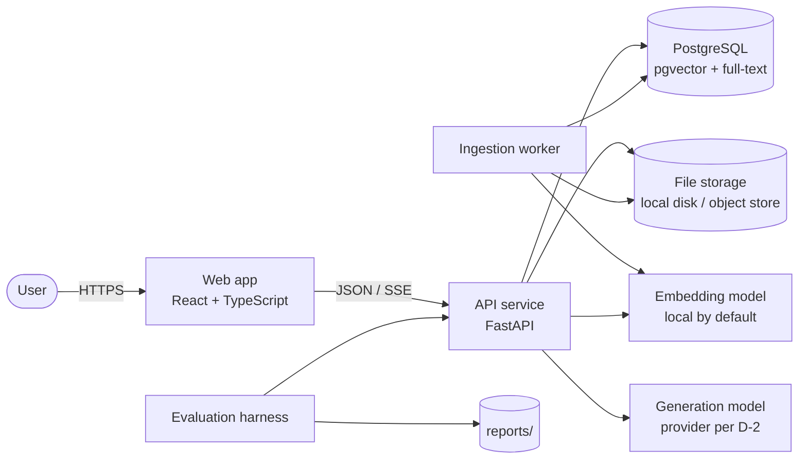
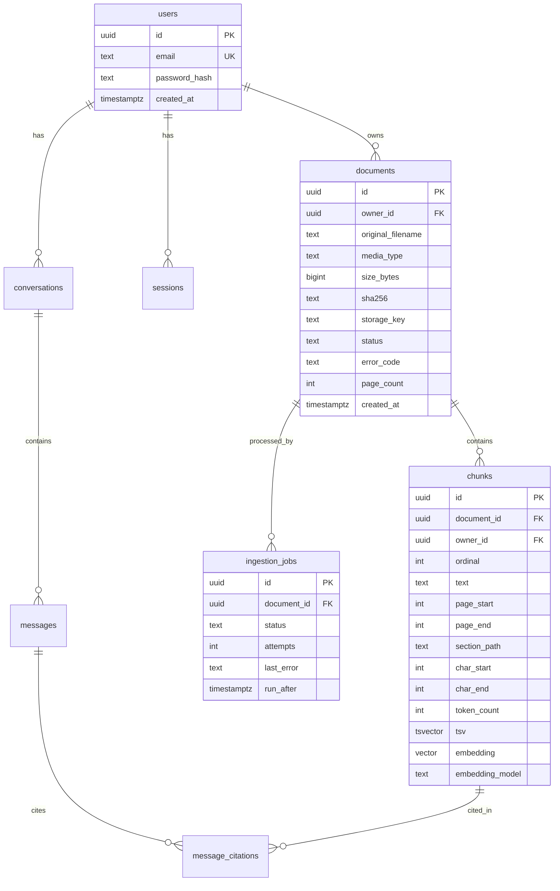
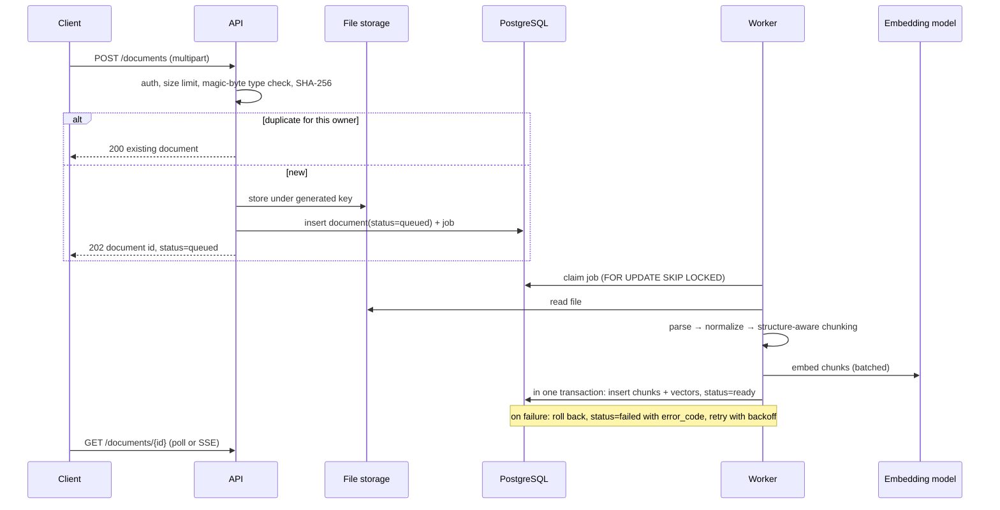
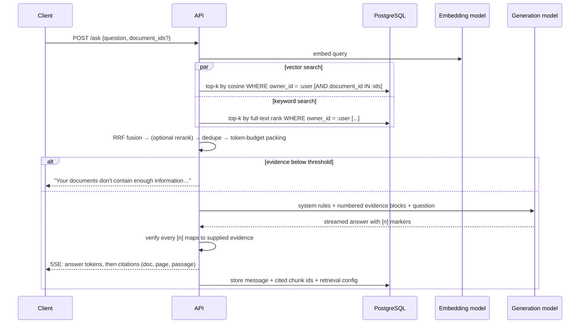

# Architecture

> **Status:** target architecture for v1. **Nothing is implemented yet.** Each
> section names the roadmap phase where it lands. Technology choices and their
> trade-offs are recorded in [ADR-0001](decisions/0001-technology-stack.md);
> requirements are in [requirements.md](requirements.md).

## 1. Principles

1. **Evidence first.** Every answer can be traced back to stored chunks. A
   citation that does not map to retrieved evidence is a bug.
2. **Isolation at the data layer.** Ownership filters are part of every query
   that reads documents, chunks or vectors. They are never applied afterwards
   in application code.
3. **Documents are untrusted input.** They can contain malicious files or
   prompt-injection text, and are handled as data, never as instructions.
4. **Swappable, measurable stages.** Parsing, chunking, embedding, retrieval,
   reranking and generation sit behind interfaces, so each can be evaluated
   and replaced on its own.
5. **Few moving parts.** One database, one API service, one worker and one
   frontend.

## 2. System context



| Component | Responsibility | Phase |
| --- | --- | --- |
| Web app | Sign-in, upload, document library, chat, citation viewer | 6 |
| API service | Auth, validation, document CRUD, retrieval, answer streaming | 1–5 |
| Ingestion worker | Parse → normalize → chunk → embed → index, with status and retries | 2–3 |
| PostgreSQL | Users, sessions, documents, chunks, vectors, full-text index, job queue | 1 |
| File storage | Original uploaded files, stored under generated names | 2 |
| Embedding model | Text → vectors for chunks and queries | 3 |
| Generation model | Grounded answer with citation markers | 4 |
| Evaluation harness | Golden dataset runs, metrics, reports, CI regression gate | 3, 7 |

## 3. Repository layout (target)

```text
src/production_rag/        Python package (backend + worker + evaluation)
  api/                     FastAPI routers, request/response schemas
  core/                    settings, logging, errors, security helpers
  db/                      SQLAlchemy models, repositories, session handling
  ingestion/               file validation, parsers, normalization, chunking, pipeline
  retrieval/               embedding providers, vector + keyword search, fusion, reranking
  generation/              context assembly, prompts, LLM providers, citation verification
  auth/                    accounts, password hashing, sessions
  worker/                  job queue consumer
  evaluation/              dataset loading, metrics, runners, report writers
migrations/                Alembic migrations
tests/                     unit/, integration/, e2e/, fixtures/ (synthetic or public-domain only)
frontend/                  React + Vite application
configs/                   retrieval and evaluation configuration files
evaluations/               versioned golden datasets
reports/                   generated evaluation reports
data/                      local-only working data (git-ignored)
docs/                      requirements, architecture, methodology, ADRs, status
```

## 4. Data model (initial)



Notes:

- `chunks.owner_id` is denormalized deliberately. Vector and full-text queries
  can then filter by owner without a join, and the filter cannot be forgotten.
- `(owner_id, sha256)` is unique on `documents`, which implements duplicate
  detection (FR-4).
- `embedding_model` and the vector dimension are recorded per chunk. A model
  change is an explicit re-embedding migration.
- Deleting a document cascades to its chunks, jobs and citations, and deletes
  the stored file (FR-5).

## 5. Ingestion flow (Phases 2–3)



Failure handling covers empty files, encrypted or corrupt PDFs, files with no
extractable text (scanned PDFs until OCR lands), files over the size limit,
and unsupported types. Each produces a stable `error_code` and a clear message
for the user.

## 6. Question-answering flow (Phases 3–4)



### Retrieval details

- Both retrievers apply the owner filter, and the optional document filter,
  **inside** the SQL query.
- Candidate depth (for example, 50 per retriever), the RRF `k` and the final
  evidence count are configuration values in `configs/`, recorded with every
  evaluation run.
- Near-duplicate chunks (overlap or repeated boilerplate) are removed before
  context packing.

### Grounding and citation verification

- Evidence is passed as numbered, delimited blocks. Each block carries its
  document title and page, with clear boundaries around the text.
- The system prompt states that the evidence is **untrusted data**, that
  instructions inside it must be ignored, and that every claim must cite an
  evidence number or be marked as unsupported.
- After generation, the server parses the citation markers:
  - A marker pointing to evidence that was not supplied is removed, and the
    event is logged as a citation-validity failure (target: never).
  - A sentence that makes a factual claim without a citation is flagged in
    evaluation.
  - A quoted span must appear verbatim in the cited chunk.
- **Abstention** has two layers: a retrieval-score threshold before
  generation, and an explicit "insufficient evidence" response format the
  model is instructed to use.

## 7. Security architecture (Phase 5, with rules applied from Phase 1)

| Boundary | Control |
| --- | --- |
| Browser ↔ API | HTTPS. HttpOnly, Secure, SameSite session cookies. CSRF protection. Strict CORS. Rate limits on auth, upload and ask. |
| API ↔ data | Every repository function requires `owner_id`. Isolation test suite. Row-level security considered as defense in depth. |
| Uploaded files | Content-based type detection, size limits, generated storage names (never a path built from the user's filename), parsing in the worker process only, page and character limits to prevent resource exhaustion. |
| Documents ↔ model | Evidence delimited and labeled as untrusted. No tools or actions available to the model. Output post-processed and verified. |
| Secrets | Read from environment variables only. `.env` git-ignored. gitleaks in CI. Secrets never logged. |
| Logs | Structured metadata only: IDs, timings, counts, error codes. No document text, questions or answers. |

## 8. Observability (Phases 1 and 8)

- Structured JSON logs with a request ID that is propagated to the worker.
- Per-stage timings: parse, chunk, embed, vector search, keyword search,
  fusion, rerank, generation (time to first token and total).
- Token counts and model identifiers per answer, for cost tracking.
- Health and readiness endpoints for the API and the worker.

## 9. Evaluation architecture (Phases 3 and 7)

- **Golden dataset:** versioned JSONL files in `evaluations/`. Each item has
  an `id`, `question`, `answerable`, the expected document and chunk or page
  references, a `reference_answer`, and `tags` (for example `multi-hop`,
  `conflicting`, `unanswerable`, `injection`).
- **Runner:** ingests a fixed public corpus and runs each question with a named
  configuration. It writes raw results (per-question retrievals, answers and
  citations) separately from aggregated reports in `reports/`.
- **Metrics:** Recall@k, MRR, nDCG; citation validity and precision;
  groundedness; answer correctness; abstention accuracy; latency percentiles.
- **CI gate:** deterministic retrieval metrics run on every pull request that
  touches retrieval code. Model-judged metrics run on demand, with the judge
  model and prompt version pinned.

## 10. Deployment (Phase 8)

Docker images for the API, worker and frontend, plus Docker Compose for local
and single-host deployment. The production hosting target has not been chosen.
Deploying to a live environment requires the project owner's explicit approval.
