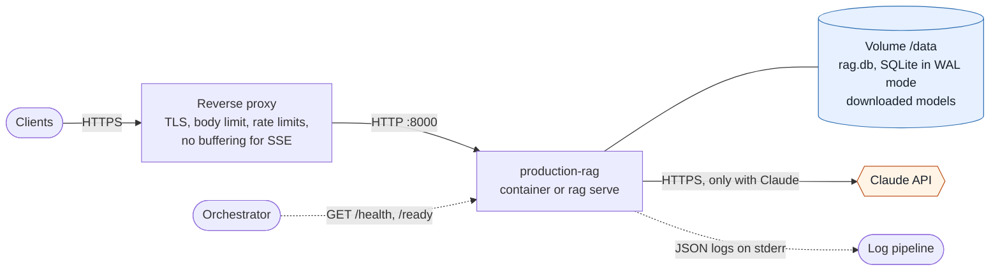

# Operations

Running the backend outside a development laptop: how to deploy, upgrade, size, monitor
and back it up, and what to do when something goes wrong.

## Reference deployment



- **One application instance per database.** SQLite allows a single writer, so the app runs
  on one machine: one container, or one `rag serve` or `uvicorn` process group.
- **A reverse proxy** terminates TLS, caps request bodies, rate-limits across processes and
  must pass `POST /v1/query/stream` through unbuffered ([Streaming](#streaming)).
- **The only outbound call** goes to the Claude API, and only with `RAG_GENERATOR=anthropic`.
  The default configuration makes no network calls at all.
- **State lives in one volume:** the database and, with fastembed, the downloaded models.

## Install and configure

```bash
uv sync --frozen --all-extras --no-dev   # exact versions from uv.lock
cp .env.example .env                     # or set the variables in your process manager
```

Recommended production settings: `RAG_EMBEDDING_PROVIDER=fastembed`,
`RAG_GENERATOR=anthropic`, `ANTHROPIC_API_KEY` from your secret store, `RAG_API_KEY` set, and
`RAG_DATABASE_URL` pointing at a persistent volume.

Pre-download the models into the image or volume so the service doesn't fetch them at
startup. `RAG_FASTEMBED_CACHE_DIR` sets where they live:

```bash
uv run python -c \
  "from production_rag.embeddings import FastEmbedEmbedder; FastEmbedEmbedder('BAAI/bge-small-en-v1.5', '/opt/models')"
# With RAG_RERANKER=fastembed, also:
uv run python -c \
  "from production_rag.retrieval.reranking import FastEmbedReranker; FastEmbedReranker('Xenova/ms-marco-MiniLM-L-6-v2', '/opt/models')"
```

### Container image

Each release is published as `ghcr.io/saicharan-nidiganti/production-rag` (tags `X.Y.Z`, `X.Y` and `latest`), built from
`uv.lock` and tested by [container.yml](../.github/workflows/container.yml) before it is
pushed: it must become ready, ingest a document, answer with citations and stream an answer.

```bash
docker run -d --name rag -p 8000:8000 -v rag-data:/data \
  -e RAG_API_KEY -e ANTHROPIC_API_KEY \
  -e RAG_EMBEDDING_PROVIDER=fastembed -e RAG_RERANKER=fastembed -e RAG_GENERATOR=anthropic \
  ghcr.io/saicharan-nidiganti/production-rag:0.2.0
```

- It runs `rag serve --migrate`: one process on port 8000, as an unprivileged user
  (uid 10001), with a `HEALTHCHECK` on `/health`.
- `/data` holds the SQLite database (`RAG_DATABASE_URL=sqlite:////data/rag.db`) and the
  downloaded models (`RAG_FASTEMBED_CACHE_DIR=/data/models`): mount a volume there.
- With no settings it runs offline: hashing embeddings and extractive answers. `-e NAME`
  without a value passes the variable from your shell, so secrets stay off the command line.
- Run one container per database: SQLite allows a single writer.

## Deploy sequence

1. `uv run rag db upgrade`: apply migrations. The service doesn't migrate on its own unless
   it is started with `rag serve --migrate`, as the container image is. `/ready` returns 503
   until the schema is at head, and ingestion
   workers retry with a backoff (logging `ingest.worker_error`) until then. Revision 0002
   adds ingestion status; documents ingested before it become `ready`.
2. Start the API: `uv run uvicorn --factory production_rag.api.app:app_factory --host 0.0.0.0
   --port 8000 --workers 4`, or `uv run rag serve --host 0.0.0.0` for a single process.
3. Point the liveness probe at `GET /health` and the readiness probe at `GET /ready`.

Run several workers on one machine if you need to. Each keeps its own vector cache, and caches
stay consistent through the `index_state` generation counter. SQLite allows a single writer, so
don't share the database file across machines or over network filesystems
([ADR-0002](decisions/0002-v0-storage-and-scope.md) lists when to move to PostgreSQL).

Put a reverse proxy in front for TLS and to cap request bodies at `RAG_MAX_UPLOAD_BYTES`. The
app enforces the limit too, but only after the body has been received.

## Upgrading and rolling back

1. Read the release notes and the [changelog](../CHANGELOG.md) for new settings and
   behaviour changes.
2. Back up the database ([Backups](#backups)).
3. Install the new version: `git pull && uv sync --frozen --all-extras --no-dev`, or pull the
   new image tag.
4. Apply migrations with `rag db upgrade`; the container image does this when it starts.
   `rag db current` prints the schema revision and the latest one.
5. Restart, then check that `/ready` returns 200 with `schema_revision` equal to
   `expected_revision`, and ask one question.

To roll back, run the previous version. If the upgrade applied a migration, restore the
backup from step 2 first: there is no `rag db downgrade` command. 0.1.0 and 0.2.0 share
schema revision 0003, so moving between them needs no migration.

## Sizing

| Resource | What drives it | Measured or estimated |
| --- | --- | --- |
| Memory | The in-memory vector matrix in each process: chunks × dimensions × 4 bytes (384 for bge-small, 512 for hashing), plus the ONNX models with fastembed | 100,000 bge-small chunks need about 150 MB per process |
| Disk | Extracted text, chunks with overlap, embeddings and the FTS5 index; failed uploads until they are retried or deleted | Measured: 2,743 chunks of about 840 characters with bge-small took 14.8 MB, about 5.3 KiB per chunk, 7.5 times the extracted text |
| CPU, ingestion | Embedding, which uses every core | Measured: about 20 chunks per second with bge-small on an 8-core laptop CPU |
| CPU, queries | Exact vector search, BM25 and the optional reranker | Measured: about 0.5 ms of vector search per query at 10,000 chunks and 6 ms at 100,000; reranking 5 candidates about 30 ms |

Vector search is exact, which stays comfortable to about 100,000 chunks per process. Beyond
that, plan the move to PostgreSQL with pgvector
([ADR-0002](decisions/0002-v0-storage-and-scope.md)).

## Streaming

`POST /v1/query/stream` answers with Server-Sent Events
([ADR-0010](decisions/0010-streaming-answers-over-sse.md)). Behind a reverse proxy:

- Don't buffer it. The response sends `X-Accel-Buffering: no`, which nginx honours; for
  other proxies, turn response buffering off for that path.
- Allow quiet periods. Before the first text, Claude may think for a while and nothing is
  sent; the proxy's read or idle timeout must be longer than `RAG_ANTHROPIC_TIMEOUT_S`.
- A client that disconnects stops the generation within one event, so abandoned answers
  aren't billed to the end.

## Rate limits

The API limits each client address per minute: by default 30 uploads and retries, 60
questions, 120 searches, 600 other `/v1` requests and 10 failed API-key attempts
([configuration.md](configuration.md#api-and-logging)). A client over a limit gets 429
`rate_limited` with `Retry-After`, and the API logs `security.rate_limited` with the operation
and the client address.

The limits are kept in each process's memory:

- With `--workers N`, each process keeps its own allowance, so a client can make up to N times
  a limit. Set each limit to about the total you want divided by N if the total must hold.
- A restart resets them.
- The client is the address uvicorn reports. Behind a reverse proxy, list the proxy in
  uvicorn's `--forwarded-allow-ips` so it uses `X-Forwarded-For`; otherwise every client
  shares the proxy's address and one allowance. IPv6 clients are grouped by /64.

For a limit that holds across processes or machines, rate-limit at the reverse proxy too; the
built-in limits are then a backstop in each process.

## Background ingestion

Uploads return `202` and are processed by worker threads inside each API process
(`RAG_INGEST_WORKERS`, default 1). With `--workers 4`, four processes each run one thread;
they share the queue through the database and never process the same document twice. Clients
poll `GET /v1/documents/{id}` until the status is `ready` or `failed`
([api.md](api.md#processing-status)). `rag ingest` doesn't use the queue: it processes each
file before moving on.

| Situation | What happens | Operator action |
| --- | --- | --- |
| Processing error (bad file, embedding failure) | `failed` with `error.code` and `error.message`; no chunks are written; the upload is kept | Fix the cause, then `POST /v1/documents/{id}/retry` (or re-upload). Errors are never retried automatically |
| Graceful shutdown (SIGTERM, deploy) | Workers stop at the next embedding batch and hand the document back as `queued`, without counting the attempt; shutdown waits up to 10 s | None: the next start picks it up |
| Crash, kill or power loss mid-way | The document stays `processing` until its lease lapses (`RAG_INGEST_LEASE_S`, default 5 min), then any worker takes it over | None. To recover sooner after a known crash, restart with a shorter lease |
| A file that hangs or exhausts the parser | The parser process is killed after `RAG_PARSE_TIMEOUT_S` (or hits `RAG_PARSE_MEMORY_MB` on Linux and macOS); the document fails with `parse_timeout` or `parse_failed`; the service is unaffected | Raise the limit if the file is legitimate, then retry |
| Interrupted `RAG_INGEST_MAX_ATTEMPTS` times (default 3) | `failed` with code `interrupted`, so a file that crashes the process can't loop forever | Check memory and the log for that document, then retry |
| No workers anywhere (`RAG_INGEST_WORKERS=0` in every process) | Uploads stay `queued` | Run at least one process with workers |
| Restart with work queued | Queued documents and their uploads are in the database; workers continue after startup | None |

Watch `/ready`: `checks.ingestion` gives documents by status and the live worker threads of the
process that answered. A growing `queued` count means workers can't keep up or aren't running;
`processing` that never drains points at a stuck or crashed worker. Failed documents keep their
upload in the database: delete the ones you won't retry.

Concurrent writes still go through SQLite's single writer. Workers hold the write lock only
briefly (claims, lease renewals) and once per document to write its chunks, and queries never
wait on it (WAL). Raising `RAG_INGEST_WORKERS` rarely helps: embedding already uses every CPU
core.

## Reranking

With `RAG_RERANKER=fastembed`, each query also runs a local cross-encoder over
`RAG_RERANK_CANDIDATES` passages (default 5; about 30 ms on a laptop CPU, or about 250 ms
with 20 candidates). Pre-download its model the same way as the embedding model
(`production_rag.retrieval.reranking.FastEmbedReranker`). After changing `RAG_RERANKER_MODEL`,
set `RAG_MIN_RERANK_SCORE` from a new calibration: only `Xenova/ms-marco-MiniLM-L-6-v2` has a
calibrated default, and other models never abstain on rerank score
([evaluation.md](evaluation.md#calibrating-abstention)).

## Changing the embedding model

Each chunk records the model that embedded it, and vector search uses only chunks from the
configured model. After changing `RAG_EMBEDDING_PROVIDER` or `RAG_FASTEMBED_MODEL`:

```bash
uv run rag reindex      # re-embeds every chunk from another model; prints counts
```

`/ready` reports `stale_chunks` until this has run. Lexical search keeps working in the
meantime. Re-run `rag eval` with the new model and recalibrate `RAG_MIN_VECTOR_SCORE`.

## Logs and monitoring

Logs are JSON lines on stderr. Useful fields and signals:

| Signal | Source |
| --- | --- |
| Request rate, latency and errors by path | `event = http.request` (`status`, `duration_ms`, `path`) |
| Answer outcomes | `event = query.completed`: count by `status`; watch the `insufficient_evidence` share |
| Pre-generation abstentions | `query.completed` with `abstained_before_generation = true` |
| Stage latency | `query.completed.timings_ms.retrieval` / `.generation`; for streamed answers (`streamed = true`) also `.first_token`, the time to the first text |
| Model usage and cost | `event = generation.completed`: `input_tokens`, `output_tokens`, `model` |
| Ingestion throughput and failures | `ingest.queued`, `ingest.completed` (`chunks`, `duration_ms`), `ingest.failed` (`error_code`, `attempt`) |
| Ingestion recovery | `ingest.recovered` (a lapsed lease was taken over), `ingest.claim_lost` (a late worker's result was discarded), `ingest.released` (handed back at shutdown) |
| Ingestion worker health | `ingest.worker_error` (database unavailable or not migrated; retried with a backoff up to 30 s), `ingest.lease_renewal_failed` |
| Refusals | `event = generation.refused` (`category`) |
| Security refusals | `security.auth_failed` (`reason`), `security.rate_limited` (`operation`, `retry_after_s`), `security.request_too_large`; each with the client address |
| Upstream failures | `event = generation.failed` (`retryable`); HTTP 502/503 |

Every log line within a request carries `request_id`, which is also returned as `X-Request-ID`.
`generation.completed` also logs `anthropic_request_id`; quote it when reporting an API problem
to Anthropic. Question text and document contents are never logged.

### Alerts worth setting

Starting points; tune the thresholds to your traffic.

| Alert | Condition | Usual cause |
| --- | --- | --- |
| Not ready | `/ready` isn't 200 for 2 minutes | Schema behind after an upgrade; database unreachable |
| Ingestion backlog | `checks.ingestion.queued` keeps growing for 15 minutes | No process runs workers, or workers fail (`ingest.worker_error`) |
| Stuck processing | `processing` stays above 0 with no `ingest.completed` for longer than `RAG_INGEST_LEASE_S` | A worker died; the lease hands the document over |
| Server errors | 5xx above 1% of `http.request` over 5 minutes | Unexpected errors: look up the `request_id` |
| Model unavailable | `generation.failed` with `retryable = true`, or 503 `generation_unavailable`, above your baseline | Claude rate limits or overload |
| Abuse | Spikes of `security.auth_failed` or `security.rate_limited` | A misconfigured client, or key guessing |
| Slow answers | p95 of `query.completed.timings_ms.total` above your target | Large corpus, reranking many candidates, or a slow model |

## Backups

The database is a single SQLite file in WAL mode. Copying the file alone can miss what is in
the write-ahead log, so take backups with SQLite's backup API. This works while the service
runs, and inside the container image, which has Python but not the `sqlite3` shell:

```bash
python -c "import sqlite3; d = sqlite3.connect('rag-backup.db'); sqlite3.connect('/data/rag.db').backup(d); d.close()"
docker exec rag python -c "..."          # the same command, inside a running container
```

To restore: stop the service, replace `rag.db` with the backup, delete any `rag.db-wal` and
`rag.db-shm` left beside it, start the service and check `/ready`. Documents can be
re-ingested from their sources, but the database is the only copy of the extracted text and
the ingestion metadata.

## Security

Security controls, data flows to the model provider, known gaps and an operator
checklist are in [security.md](security.md). All settings are listed in
[configuration.md](configuration.md).

## Troubleshooting

| Symptom | Cause and fix |
| --- | --- |
| `/ready` 503 with `schema: not at head` | Run `rag db upgrade` |
| Documents stay `queued` | No process runs workers (`checks.ingestion.workers` is 0 everywhere), or workers log `ingest.worker_error`. Start a process with `RAG_INGEST_WORKERS` ≥ 1, or fix the database error |
| A document stays `processing` for minutes | Its worker died; it's taken over once the lease lapses (`RAG_INGEST_LEASE_S`). Large PDFs can also simply take that long: check for `ingest.completed` |
| `failed` with `internal_error` | The message names the exception type; the full error is in the `ingest.failed` log line. Fix it, then retry |
| HTTP 502 `generation_failed`, "no Claude API credentials configured" | Set `ANTHROPIC_API_KEY` (read by the SDK, without the `RAG_` prefix) |
| "the Claude API account has no credit left" (HTTP 502 `generation_failed`, or from `rag eval --plan --count-tokens`) | The key authenticates but the account's credit balance is empty; even token counting is refused. Add credits under Plans & Billing in the Claude Console |
| HTTP 503 `generation_unavailable` | Rate limit, overload or network failure after SDK retries; retry later, check `generation.failed` logs |
| Many `insufficient_evidence` answers | Check `best_vector_score` in `query.completed`: if it's low, the corpus may lack the content; if retrieval looks right, run `rag eval` and recalibrate the threshold |
| fastembed fails with "Could not load model … from any source" | Often not the network: Hugging Face downloads large files through its Xet client, which writes to `~/.cache/huggingface`. If that isn't writable, set `HF_HOME` and `RAG_FASTEMBED_CACHE_DIR` to writable directories |
| Streamed answers arrive all at once, at the end | A proxy buffers the response. Turn buffering off for `/v1/query/stream` ([Streaming](#streaming)) |
| Clients get 429 `rate_limited` | Over a per-client limit; `Retry-After` says when to try again. Behind a proxy that isn't in `--forwarded-allow-ips`, all clients share one allowance. Raise `RAG_RATE_LIMIT_*_PER_MINUTE` if the limits are too low ([Rate limits](#rate-limits)) |
| The container can't write to `/data` | A bind-mounted host directory owned by another user: the image runs as uid 10001. `chown 10001` the directory, or use a named volume |
| `database is locked` | Concurrent writers beyond what SQLite handles; reduce concurrent ingestion or move to PostgreSQL ([ADR-0002](decisions/0002-v0-storage-and-scope.md)) |
| Windows: "An Application Control policy has blocked this file" for `pytest.exe` | OS policy on unsigned launcher shims; run `uv run python -m pytest` instead |
